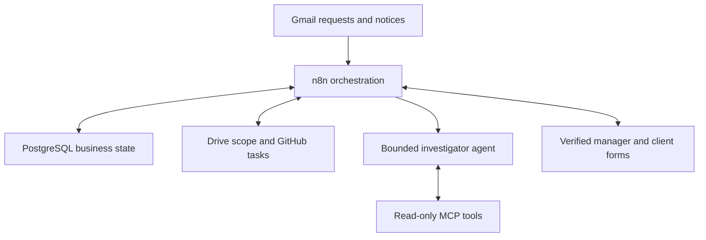

# Architecture

## Deployment topology
Alternate Clouds hosts n8n and PostgreSQL (native database service if suitable; otherwise a supported PostgreSQL container/server with persistent storage). The three external business systems are Gmail, Drive/Docs and GitHub. AI inference uses a credentialed supported model endpoint; verify whether event rules mandate the platform model gateway. No such mandate has been assumed.

## Key separation
- n8n operational DB stores workflows, credentials and execution state. Business tables live in a separate database/schema with a separately privileged credential.
- The agent has read-only domain tools and a structured recommendation output. Execution workflows use write credentials after database authorization.
- A human pause is a durable database status. An execution can end while awaiting a decision; a new webhook resumes business processing. Do not require a single multi-day n8n execution.
- Wait nodes may implement reminders or a basic demonstration but their resume URL is not the authority to accept a proposal.
- Fixed project mapping determines repository, document IDs and decision maker. User/model-supplied URLs never choose arbitrary destinations.

## Services and credentials
Start with one n8n instance and one background execution worker path, not a queue-mode cluster. PostgreSQL locking still guards against webhook concurrency. TLS ingress must support webhook POSTs, OAuth callbacks and MCP transport. Confirm persistent volumes and secret configuration before adding features.

## Integration adapter pattern
Use official nodes where their operation is sufficient, HTTP Request with a stored credential otherwise. Every adapter returns a normalized provider result with resource ID, observed revision/hash, HTTP outcome and verification evidence. HTTP 2xx is not sufficient if the operation is asynchronous or fields were ignored.

## Version strategy
Store normalized scope JSON with stable deliverable IDs. Generate a new Google document for each revision instead of repeatedly overwriting one long document. Keep the original agreement unchanged. Initial onboarding requires the manager to verify extracted deliverables against the source. The current active pointer exists in PostgreSQL; a published document has a visible revision banner.

A changed source document during proposal review invalidates approval. Prefer immutable copied scope versions; if edit access remains, compare live revision/hash at preflight.

## Extensibility
Optional React UI later calls the same authenticated webhooks. Optional CRM integration later uses the same action journal. Neither is required for the MVP. Do not expose the n8n editor to clients.
